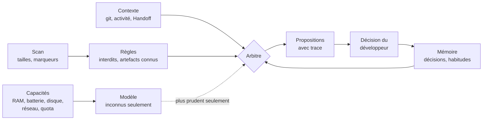

# Delest — document de conception de l'assistant d'espace disque pour développeurs

20 octobre 2026 · Kaabaoui Othman

## Contexte et problème

Delest repère sur le poste d'un développeur ce qui peut être supprimé sans altérer son travail (dépendances, artefacts de compilation, caches, modèles en double) et libère l'espace avec son accord.

Le constat de départ tient en trois points :

- **L'espace fond vite.** Plusieurs stacks, plusieurs projets : chaque dossier de dépendances, de compilation ou de cache pèse de quelques centaines de Mo à plusieurs dizaines de Go. Le seul dossier `target/` de Vario pèse 14 Go ; le poste de développement n'a plus qu'environ 62 Go libres.
- **Inspecter coûte du temps.** Il faut ouvrir les dossiers un à un, mesurer, puis chercher sur internet ou auprès d'une IA si la suppression est sans risque pour le projet.
- **L'erreur coûte cher.** Supprimer un `.env`, une base de données locale ou un travail non commité est irréversible ; supprimer des dépendances sans réseau rend un projet inutilisable.

**Public de la première version** : les développeurs qui travaillent sur plusieurs stacks sur un même poste, sous macOS, Linux et Windows, avec ou sans agents d'IA.

**Hors périmètre en v1** : le nettoyage général du système (photos, téléchargements, applications), les serveurs et flottes de machines, les disques réseau.

## Positionnement

Delest est le troisième outil d'une même famille, chacun sur un levier : [Handoff](https://github.com/kdev1966/Handoff-CLI) garde la mémoire des projets, [Vario](https://github.com/kdev1966/vario) économise les tokens et le quota, Delest économise l'espace disque. Les trois sont indépendants ; Delest détecte les deux autres et s'en sert quand ils sont là.

| Outil | Rôle | Ce qui manque pour notre besoin |
|---|---|---|
| `npkill`, `kondo` | trouver et supprimer `node_modules` ou les dossiers de compilation | une seule famille d'artefacts, aucun contexte de projet |
| DevCleaner | nettoyer les données de Xcode | un seul écosystème |
| `ncdu`, `dust` | mesurer l'occupation du disque | mesurent sans juger ce qui est supprimable |
| `docker system prune`, `cargo clean` | nettoyer leur propre outil | chacun pour soi, sans vue d'ensemble |
| CleanMyMac et équivalents | nettoyage général | pas pensés pour les artefacts de développement |
| storage_ballast_helper | démon qui prévient les disques pleins sous la charge des agents de code | voir la note ci-dessous |

Delest s'en distingue par quatre choix : comprendre le contexte de chaque projet (Handoff, git, activité), un Brain qui arbitre et apprend des décisions du développeur, une IA embarquée facultative avec un dépôt de modèles commun, et un fonctionnement en ombre déclenché par les sessions de travail.

**Note sur storage_ballast_helper.** Sa licence (« MIT with OpenAI/Anthropic Rider ») interdit toute utilisation, y compris l'analyse, par OpenAI, Anthropic et leurs agents. Son analyse a été arrêtée le 20 octobre 2026 et ce document ne s'appuie ni sur son code ni sur sa documentation ; seule sa description publique a servi au positionnement.

## Principes directeurs

Huit principes guident toutes les décisions ; en cas de conflit, ils s'appliquent dans cet ordre.

1. **Ne jamais abîmer le travail.** Un Go récupéré ne vaut pas un fichier perdu. Dans le doute, on garde.
2. **Réversible avant définitif.** La quarantaine passe avant la suppression ; la suppression définitive est réservée à ce qui se reconstruit à l'identique.
3. **Le modèle propose, le code décide.** Aucun modèle ne rend un dossier supprimable ; un modèle peut seulement rendre Delest plus prudent.
4. **Fonctionner sans IA.** Les règles et la mémoire suffisent au cœur du travail ; l'IA, embarquée ou par les agents, n'est qu'un renfort.
5. **Discret.** Delest ne se manifeste que pour une alerte, un avis utile ou à la demande ; il n'a aucun processus permanent.
6. **Sobre.** Un outil qui libère de l'espace ne doit pas en gaspiller : modèles facultatifs, téléchargés à la demande, partagés et dédupliqués, chargés le temps d'une tâche.
7. **Local et respectueux.** Rien n'est envoyé à un tiers par Delest lui-même ; aucun contenu de fichier n'est lu au-delà des marqueurs nécessaires ; chaque action est tracée et annulable.
8. **Honnêteté sur les limites.** Ce que Delest ne sait pas classer est dit « inconnu », jamais deviné.

## Ce que Delest reconnaît

### Catégories

Chaque élément reconnu porte une catégorie, un coût de reconstruction et un mode de reconstruction.

| Catégorie | Exemples | Reconstruction | Proposé hors ligne |
|---|---|---|---|
| **Compilation** | `target/`, `build/`, `dist/`, `.next/`, `DerivedData`, `.dart_tool/`, `__pycache__` | locale, si les dépendances sont présentes | oui |
| **Dépendances de projet** | `node_modules`, `.venv`, `Pods`, `vendor/` | réseau, à l'identique si un lockfile existe | non |
| **Caches globaux** | `~/.npm`, `~/.cache/pip`, `~/.cargo/registry`, `~/.gradle/caches`, `~/.m2`, Homebrew, CocoaPods | réseau | non |
| **Outils de plateforme** | simulateurs et archives Xcode, images inutilisées, caches de compilation et conteneurs arrêtés de Docker, AVD Android | réseau ou réinstallation | non |
| **Modèles d'IA** | GGUF et caches Hugging Face, Ollama, LM Studio | réseau ; copies en double fusionnées sans perte | dédoublonnage seulement |
| **Inconnu** | tout le reste au-delà d'un seuil de taille | — | jamais |

### Interdits absolus

Aucun signal, aucune habitude, aucun modèle ne lève ces interdits :

- tout fichier suivi par git avec des modifications non commitées, et tout fichier non suivi qui n'est pas ignoré ;
- les secrets et la configuration locale : `.env*`, clés, certificats, fichiers de configuration d'IDE propres au développeur ;
- les données : bases SQLite et autres fichiers de base de données, volumes Docker, dossiers de données d'émulateurs ;
- le code source et les manifestes de projet ;
- tout chemin protégé par le développeur.

Un fichier ignoré par `.gitignore` n'est donc pas supprimable pour autant : `.env` et les bases locales sont souvent ignorés et pourtant précieux.

### Signaux de contexte

- **Reconstruction** : présence d'un lockfile (`package-lock.json`, `pnpm-lock.yaml`, `Cargo.lock`, `poetry.lock`, `Podfile.lock`…), outil de compilation détecté.
- **Activité** : date du dernier commit, des dernières modifications, et de la dernière passation Handoff ; projet ouvert dans un éditeur ou utilisé par un processus.
- **Contexte Handoff** : stack déclarée (elle annonce les artefacts attendus), état courant et prochaines actions (« version 0.3.0 en préparation » protège `dist/`).
- **Réseau** : sans connexion, rien de ce qui demande le réseau pour se reconstruire n'est proposé.

## Le Brain

Le Brain reprend la doctrine commune à AuraNote, KiraNote, think-together et un autre de mes projets d’IA, adaptée à un outil qui supprime des fichiers.

### Modules

| Module | Inspiré de | Rôle |
|---|---|---|
| **Capacités** | AuraNote | mesure la RAM libre, la batterie, l'espace restant, le réseau et le quota des agents (par Vario), et décide de ce qui peut tourner |
| **Règles** | les quatre projets | interdits absolus et artefacts connus, chacun avec sa catégorie et son mode de reconstruction |
| **Mémoire** | AuraNote, un autre projet d’IA | conserve chaque décision du développeur et en tire des habitudes : un dossier refusé trois fois n'est plus proposé |
| **Retour d'expérience** | un autre projet d’IA | une restauration depuis la quarantaine compte comme une erreur et baisse la confiance de la règle qui avait proposé ; influence bornée, avec oubli progressif |
| **Arbitre** | AuraNote, un autre projet d’IA | tranche dans l'ordre : interdits absolus, décision du développeur, habitudes apprises, règles connues, modèle |
| **Contrôle** | AuraNote, un autre projet d’IA, think-together | le modèle répond dans une liste fermée (grammaire GBNF) ; les tailles viennent toujours de la mesure ; une commande de reconstruction proposée doit correspondre à la stack détectée ; trois réponses rejetées arrêtent la tentative |
| **Trace** | AuraNote | chaque proposition dit d'où elle vient, par exemple « règle `node_modules`, lockfile présent, projet inactif depuis 94 jours (Handoff) » |

### Règles du Brain

1. **Il fonctionne sans modèle** (le « mode lab » de think-together).
2. **Le modèle ne traite que l'inconnu** et ne peut rendre Delest que plus prudent : il fait passer un dossier de « supprimable » à « à examiner », jamais l'inverse. Un dossier reconnu par le modèle mais jamais confirmé reste « à examiner ».
3. **L'apprentissage déplace les propositions mais ne lève jamais un interdit.**
4. **L'automatique s'arrête à la quarantaine.** Une action acceptée trois fois peut être proposée en automatique (le savoir-faire d'AuraNote), seulement vers la quarantaine, et seulement si le développeur l'active.
5. **Tout changement passe d'abord en ombre** : une nouvelle règle ou une habitude apprise calcule ce qu'elle aurait proposé, sans l'afficher, jusqu'à validation.
6. **Tout changement passe le corpus d'acceptation** (think-together) : un ensemble de vrais dossiers avec leur verdict, rejoué avant chaque changement de règle, de seuil ou de modèle. Critère bloquant : aucun élément protégé classé supprimable.

## Fonctionnement en ombre

Delest n'a aucun processus permanent. Deux déclencheurs le réveillent :

1. **Les hooks des agents** : au début de chaque session (Claude Code, Codex, Cursor, Gemini CLI, VS Code avec Copilot, OpenCode et Kiro), Delest vérifie instantanément l'espace libre, puis lance en tâche détachée, à basse priorité, un scan incrémental du projet en cours. Il n'ajoute aucun texte à la session, sauf alerte. Chaque agent reçoit la réponse dans la forme qu'il attend (`additional_context` pour Cursor, `systemMessage` et `additionalContext` pour les autres). Cursor exécute aussi les hooks de Claude Code : quand le hook de Delest pour Cursor est en place, la copie de Claude Code s'efface, pour que la vérification ne tourne pas deux fois. Codex n'exécute un nouveau hook qu'une fois approuvé avec `/hooks` ; VS Code, quand le réglage `chat.useHooks` est activé. OpenCode n'a que des greffons : Delest y place le sien, `plugins/delest.js`, qui lance le hook au démarrage ; l'alerte passe alors par la notification système. Kiro ne lance que les hooks de l'agent choisi, inscrits dans le fichier de cet agent : il n'a pas d'emplacement commun à toutes les sessions. Ce sont donc les agents que Vario génère pour Kiro qui portent le hook de Delest, quand Delest est installé ; Delest n'écrit jamais dans les fichiers de Vario, et le texte d'une alerte va tel quel dans le contexte de l'agent.
2. **Une minuterie système facultative**, désactivée par défaut (launchd, timer systemd, Planificateur de tâches Windows), toutes les quelques heures, pour le travail fait sans agent ; elle ne vérifie que l'espace libre et rafraîchit l'index.

Un index conserve la taille et la date de chaque dossier mesuré : seuls les dossiers modifiés depuis le dernier passage sont remesurés.

| Manifestation | Quand | Où |
|---|---|---|
| **Alerte** | l'espace libre passe sous le seuil | notification système, et une ligne dans la session de l'agent |
| **Avis** | un gain récupérable important est apparu, au plus une fois par jour et par projet | notification système |
| **Compte rendu** | à la demande, ou en fin de session si le développeur l'active | commande, interface |

En mode ombre, Delest ne supprime jamais rien. La suppression n'a lieu qu'en mode manuel, par la commande ou l'interface, après aperçu et confirmation.

## Intelligence artificielle

### Niveaux

| Niveau | Hors ligne et sans quota | Rôle |
|---|---|---|
| 1. Règles intégrées | oui | artefacts connus |
| 2. Règles apprises | oui | verdicts déjà rendus, enregistrés en local : une question n'est jamais posée deux fois |
| 3. Modèle embarqué (facultatif) | oui | reconnaître un dossier inconnu et proposer une catégorie |
| 4. Agents du développeur | non | cas difficiles et explications détaillées |

Sans IA disponible, un dossier inconnu est montré avec sa taille et reste « à examiner » ; les questions attendent dans une file la prochaine occasion. Les alertes ne dépendent jamais de l'IA.

### Modèle embarqué

Un duo de la même famille, chargé le temps d'une tâche puis déchargé :

- **EmbeddingGemma 2** (environ 310 Mo en Q8_0) pour reconnaître : la description d'un dossier inconnu (nom, marqueurs, contenu de premier niveau) est comparée aux règles connues ;
- **Gemma 4 E2B** (environ 3 Go en 4 bits) pour raisonner sur ce qui reste inconnu et expliquer, avec réponse contrainte par une grammaire GBNF ; en repli, pour les postes trop justes, **Qwen3.5 2B** (environ 1,3 Go en Q4_K_M, Apache 2.0).

Le choix final se fait sur le corpus, en mesurant sur le poste de référence (Intel Core i7-4870HQ, AVX2, sans GPU exploitable, 16 Go de RAM) la justesse, la vitesse et la RAM des deux candidats. Le moteur est llama.cpp, par des bindings Rust (le crate `llama-cpp-2` est un candidat, à évaluer).

Les modèles ne sont jamais inclus dans Delest : ils se téléchargent à la demande, et s'ils ne servent plus, Delest les signale lui-même comme récupérables.

**Mesures du 20 octobre 2026** sur le poste de référence, avec llama.cpp compilé pour le processeur seul (b11450, puis b11756 pour EmbeddingGemma 2). Le banc est `scripts/banc_modeles.py`. Il porte sur 120 entrées du corpus, dont 30 pièges et tous les éléments protégés ou à juger, décrites par leur nom, les marqueurs du dossier parent, leurs noms de premier niveau et leur état git. Aucun contenu de fichier n'est lu. Les interdits absolus écartent 47 entrées avant le modèle ; les 73 autres sont celles qu'il juge vraiment.

Les deux rôles du duo se mesurent séparément : EmbeddingGemma 2 produit des vecteurs pour la recherche sémantique, Gemma 4 E2B génère du texte et raisonne. Leurs chiffres ne se comparent pas entre eux.

**Reconnaissance (embeddings).** Chaque entrée est comparée aux autres entrées du corpus, et le verdict majoritaire de ses trois plus proches voisins est retenu.

| Modèle | Justes (120) | Justes (73) | Protégés classés supprimables (73) | Secondes par entrée | RAM |
|---|---|---|---|---|---|
| EmbeddingGemma 2 Q8_0 | 72 % | 70 % | 0 | 0,3 | 0,3 Go |

Ce score mesure surtout la qualité du corpus : il est probablement surestimé, car le corpus contient beaucoup de dossiers presque identiques (par exemple des `__pycache__` voisins), et il reproduit les verdicts déjà fixés par le développeur, comme le ferait le module des habitudes apprises.

**Classement et raisonnement (génération).** Le modèle reçoit la description sans exemple, et sa réponse est contrainte par une grammaire GBNF.

| Modèle | Justes (120) | Justes (73) | Protégés classés supprimables (73) | Secondes par entrée | RAM |
|---|---|---|---|---|---|
| Gemma 4 E2B Q4_0 | 40 % | 41 % | 0 | 11,3 | 2,6 à 3,1 Go |
| Qwen3.5 2B Q4_K_M (repli) | 58 % | 45 % | 0 | 8,3 | 1,9 à 3,3 Go |
| Gemma 3 1B Q4_K_M | 39 % | 5 % | 0 | 5,1 | 1,0 à 1,5 Go |

**Banc amélioré** (même jour). Les doublons sont retirés : 84 entrées, dont 48 laissées au modèle après les interdits. Le modèle reçoit en exemples les trois voisins trouvés par EmbeddingGemma 2, avec leur verdict, et une consigne qui présente « à juger » comme la réponse attendue en cas de doute.

| Modèle | Justes (84) | Justes (48) | « À juger » classés supprimables | Protégés classés supprimables (48) | Secondes par entrée | RAM |
|---|---|---|---|---|---|---|
| EmbeddingGemma 2 seul (trois voisins) | 68 % | 58 % | 1 sur 19 | 0 | 0,3 | 0,3 Go |
| Gemma 4 E2B avec les voisins en exemples | 65 % | 77 % | 2 sur 19 | 0 | 18,3 | 3,7 Go |
| Qwen3.5 2B avec les voisins en exemples | — | — | — | — | environ 17 | — |

- **Le duo vaut mieux que chacun des deux modèles.** Avec les voisins en exemples, Gemma 4 E2B passe de 41 % à 77 % et apprend à répondre « à juger ». Ces deux mesures ne portent pas tout à fait sur les mêmes entrées (73 avant le dédoublonnage, 48 après), mais l'écart reste net.
- **Le score d'EmbeddingGemma 2 seul tombe de 70 % à 58 %** une fois les doublons retirés, comme prévu.
- **Qwen3.5 2B n'a pas été mesuré dans ces conditions** : le banc a été arrêté pour libérer le poste. À refaire en phase 4.

- **Gemma 4 E2B est trop permissif.** Il répond presque toujours « supprimable avec réseau », jamais « supprimable », et classe supprimables 21 des 24 éléments à juger. Le Brain écarterait ces avis, puisque le modèle ne peut que rendre plus prudent.
- **Qwen3.5 2B fait jeu égal avec Gemma 4 E2B**, un peu plus juste et plus rapide, mais il ne répond jamais « à juger » : il tranche entre protégé et supprimable, et classe supprimables 17 des 29 éléments à juger (24 dossiers et 5 caches). Mesuré avec llama.cpp b11756.
- **Gemma 3 1B répond « protégé » presque toujours.** Il est sans danger, mais il n'aide pas à décider.
- **Limites du banc** : une seule consigne, non ajustée et sans exemple ; Gemma 3 1B en Q4_K_M et non en QAT ; un seul poste ; 120 entrées.
- **Conséquence proposée** : EmbeddingGemma 2 reconnaît un élément en le rapprochant des décisions et des règles connues. Gemma 4 E2B raisonne sur ce qui reste inconnu et explique les verdicts. Le prochain banc lui donnera en contexte les voisins trouvés par EmbeddingGemma 2. L'Arbitre tranche toujours. Gemma 3 1B est écarté du repli.

**Mesure de la phase 4** (21 octobre 2026). Le corpus reçoit une section `[[inconnu]]` : 27 dossiers du poste qu'aucune règle ne reconnaissait, avec leur verdict de référence fixé par le développeur. `delest corpus --advise` les fait passer par l'Arbitre puis par le modèle, avec des avis rangés dans un dossier temporaire.

- **Deux nouveaux interdits** : `Assets` à côté de `ProjectSettings` (Unity) et `binaries` à côté de `tauri.conf.json` sont des parties du projet qu'aucune compilation ne recrée. Ils sont protégés sans passer par le modèle.
- **Deux nouvelles règles en ombre** : `Library` de Unity (cache, ses bases SQLite ne bloquent plus la règle) et `managed_components` d'ESP-IDF (supprimable avec réseau, recréé d'après `dependencies.lock`).
- **Résultat** : sans le modèle, 2 inconnus sur 27 sont bien classés. Avec les interdits, la règle en ombre et le modèle, 24 sur 27 le sont : le modèle a 21 avis justes sur les 24 qui lui reviennent. Ses 3 erreurs vont toutes dans le sens de la prudence (des dossiers libérables gardés). Aucun dossier protégé n'est classé supprimable, ni même « à juger ».
- **Le critère de la phase 4 est atteint.** Le corpus entier reste à 182 accords sur 188 (96 %), sans faux « supprimable ».

**Phase 5 : Linux et Windows** (24 octobre 2026). L'intégration continue fait passer tous les tests, application comprise, sur macOS, Linux et Windows, puis `doctor`, `scan` et la minuterie sur chaque système.

- **Corpus synthétique** (`corpus/synthetique.toml`, 34 cas) : les situations du poste de référence (compilations, dépendances avec ou sans lockfile, interdits, pièges, caches du dossier personnel, dont ceux de Windows), recréées dans un dossier temporaire avec leurs dépôts git et rejouées. Chaque dépôt a un `core.excludesFile` vide, pour que le fichier d'exclusion global du développeur ne change pas les verdicts. Résultat : verdict attendu sur les trois systèmes, aucun protégé classé supprimable. **Le critère de la phase 5 est atteint.**
- **Minuterie** : launchd sous macOS, minuterie utilisateur systemd sous Linux, Planificateur de tâches sous Windows (lancée par `conhost --headless`, sans fenêtre). Premier contrôle quatre heures après l'activation, jamais à l'ouverture de session.
- **Windows** : espace libre par l'API du système (crate `fs4`, sans `df`) ; commandes `.cmd` installées par npm ; hooks cités, car Git Bash avale les `\` d'un chemin nu ; préfixe `\\?\` retiré des chemins résolus, sans quoi ils ne commencent plus par le dossier personnel ; quarantaine par lecteur et cachée ; notifications par PowerShell, le texte passant par une variable d'environnement ; mémoire libre et batterie par CIM.
- **Paquets** : `scripts/package.sh` construit le DMG, le .deb et l'AppImage, ou l'installeur NSIS, selon le système, avec la commande `delest` à l'intérieur. La CI les garde parmi ses artefacts.
- **Reste à faire** : voir les dossiers utilisés sous Windows (pour l'instant, Delest prévient avant tout déplacement) ; cloner les modèles sous Linux (Btrfs, XFS) ; essayer notifications et jauge sur un vrai poste Linux et Windows.

**Licences des modèles** (vérifiées le 20 octobre 2026, à faire confirmer par un juriste avant toute commercialisation) :

- **Gemma 4 E2B** est sous licence Apache 2.0 et son dépôt Hugging Face n'est pas restreint : Delest peut le télécharger sans compte.
- **EmbeddingGemma 2** est sous licence Apache 2.0, sans restriction de téléchargement, y compris sa version GGUF publiée par unsloth. Il a déjà donné de très bons résultats dans AuraNote, qui l'utilise en Q8_0. La première version, EmbeddingGemma 300M, relève au contraire des Gemma Terms of Use et exige un compte Hugging Face : elle est écartée.
- **Gemma 3 1B** relève des Gemma Terms of Use et exige un compte Hugging Face ; il est écarté, ce qui supprime le seul modèle prévu hors licence open source.
- **Candidats Qwen pour le repli**, tous sous Apache 2.0 et sans restriction de téléchargement : Qwen3.5 2B (environ 1,3 Go en Q4_K_M) et Qwen3.5 0,8B, publiés en février 2026 ; Qwen2.5 1,5B, déjà présent sur le poste. Qwen2.5 3B est exclu : sa licence n'est pas open source.
- **Delest ne redistribue aucun poids**, pas même quantifié : il télécharge à la demande depuis les dépôts publics.
- Delest ne suggère aucun soutien de Google et n'utilise pas ses marques au-delà du nom des modèles.

### Agents du développeur

Delest passe par les agents déjà installés, sans clé d'API : dans la session, par un outil MCP ou un hook, la question part à un sous-agent économique (`vario-reader`) ; hors session, par la commande non interactive de l'agent (`claude -p`, `opencode run`, `gemini -p`). Seules des métadonnées sont transmises (chemins, tailles, noms de marqueurs), jamais le contenu des fichiers. Quand Vario indique un quota au-delà de 80 %, Delest reporte ses questions.

## Dépôt de modèles commun

Le développeur construit des applications d'IA locale ; un dépôt commun lui évite de télécharger et de stocker plusieurs fois les mêmes modèles, pour Delest comme pour ses autres projets.

- **Un dossier et un manifeste JSON** : `~/.local/share/kdev-models`, emplacement standard des données utilisateur ; le manifeste donne pour chaque modèle son nom, sa version, sa quantification, son empreinte SHA-256, sa taille et sa licence.
- **Une commande utilisable depuis tout langage** : `delest models list`, `path`, `pull`, `dedupe`. Un script Python, un test Rust ou une tâche Gradle obtiennent le chemin d'un modèle avec `delest models path <nom>`.
- **Réutilisation avant téléchargement** : les caches Hugging Face, llama.cpp, Ollama et LM Studio sont consultés ; un fichier identique est réutilisé.
- **Dédoublonnage sans casser les autres outils** : `delest models dedupe --replace` remplace les copies identiques par des clones copy-on-write d'une copie de référence (celle du dépôt, sinon la plus ancienne), après un aperçu et une confirmation. Chaque copie garde son nom, ses droits et sa date ; son empreinte est relue juste avant. Une copie ouverte, modifiée, sur un autre volume ou dotée d'autres noms est laissée telle quelle. APFS d'abord ; Btrfs, XFS et ReFS en phase 5. Pas de repli sur des liens physiques : une écriture dans l'une des copies modifierait toutes les autres.
- **Versions épinglées par projet**, comme un lockfile, pour des tests reproductibles.

Le dépôt commence comme un module de Delest ; il sera extrait en outil autonome si d'autres projets en dépendent. Un moteur d'inférence partagé (serveur llama.cpp lancé à la demande) pourra s'y brancher plus tard, l'accès aux modèles étant conçu pour cela.

## Sécurité des suppressions

- **Aperçu avant toute action** et confirmation explicite (ou `--yes`).
- **Quarantaine** : déplacement sur le même volume (instantané, sans copie) dans un dossier `.delest-quarantaine`, situé dans le dossier personnel pour le volume système et à la racine des autres volumes. Conservation 7 jours, plafond de 10 % du volume : au-delà, les éléments les plus anciens sont supprimés d'abord. Restauration par `delest restore`. À défaut, la corbeille du système.
- **Suppression définitive** seulement pour ce qui se reconstruit à l'identique, et toujours confirmée.
- **Revérification juste avant d'agir** : chaque dossier est réévalué ; il est retiré de l'opération si son verdict a changé depuis l'aperçu, ou si lui-même ou l'un de ses éléments de premier niveau a été modifié depuis moins de dix minutes, signe d'une compilation en cours. Un dossier dont un programme a un fichier ouvert (relevé par `lsof` juste avant d'agir) est aussi laissé en place.
- **Journal** de chaque action, avec sa trace.

## Interface

Une commande `delest` et une application Tauri `delest-gui`, sur un cœur Rust commun, comme Vario.

- **La commande** sert aux hooks, à la minuterie et au mode manuel : `delest scan`, `status`, `clean --dry-run`, `restore`, `doctor`, `install`, `remove`, `models …`.
- **L'application** rend le disque explicite par des graphiques dans l'esprit de Vario : jauge de l'espace libre, répartition par catégorie et par projet, gains récupérables par niveau de risque, historique de l'espace, propositions avec leur trace, quarantaine et restauration.

## Architecture technique

```mermaid
flowchart TB
    subgraph IF["Interfaces"]
        CLI["Commande delest<br/>mode manuel"]
        HOOKS["Hooks et minuterie<br/>mode ombre"]
        GUI["Application Tauri<br/>graphiques"]
        MCP["Outil MCP<br/>pour les agents"]
    end
    subgraph CORE["Cœur Rust (bibliothèque)"]
        SCAN["Scan et index"]
        BRAIN["Brain<br/>règles, mémoire, arbitre,<br/>contrôle, trace"]
        EXEC["Exécution<br/>quarantaine, restauration"]
        MOD["Dépôt de modèles<br/>et inférence"]
        INST["Installation dans les agents"]
    end
    subgraph RES["Ressources"]
        DISK["Disque"]
        HO["Mémoire Handoff<br/>lecture seule"]
        VA["Quota Vario<br/>lecture seule"]
        AG["Agents du développeur"]
    end
    CLI --> CORE
    HOOKS --> CORE
    GUI --> CORE
    MCP --> CORE
    CORE --> DISK
    CORE --> HO
    CORE --> VA
    CORE -.-> AG
```

**Pile** : Rust (édition 2024), Tauri 2, cargo-dist, comme Vario.

**Repris de Vario**, d'abord par copie, puis par un crate commun si la duplication devient pénible : session d'écriture avec sauvegarde (`files.rs`), dossiers de données par système (`paths.rs`), langue (`lang.rs`), installation dans les agents (`parts.rs`, `clients/`), et la discipline aperçu, `--dry-run`, `doctor`, `restore`, `remove`.

**Accès à Handoff** : en lecture seule, par la commande `handoff` ou, à défaut, par le fichier `.handoff/context.md` du projet ; jamais par sa base SQLite, dont le schéma peut changer. Ce mode fonctionne sans serveur et hors des sessions d'agent. Delest fonctionne sans Handoff.

## Feuille de route

| Phase | Contenu | Critère de passage |
|---|---|---|
| **0 · Conception** (terminée le 20 octobre 2026) | ce document ; constitution du corpus à partir du poste du développeur ; mesure des modèles embarqués sur le poste de référence ; vérification des marques et des conditions d'utilisation de Gemma | document validé, corpus constitué, modèle choisi sur mesures |
| **1 · Cœur et commande, sans IA** (terminée le 20 octobre 2026) | scan et index, règles et interdits, contexte git, Arbitre et trace, aperçu, quarantaine, restauration, `doctor` ; macOS d'abord | aucun élément protégé classé supprimable sur le corpus ; un vrai nettoyage du poste mené sans perte |
| **2 · Ombre et contexte** (développée le 20 octobre 2026 ; usage réel à mener) | hooks des agents et minuterie, alertes et avis, lecture de Handoff, mémoire des décisions et retour d'expérience, mode ombre des règles | alertes justes et peu nombreuses sur deux semaines d'usage réel |
| **3 · Application Tauri** | graphiques, propositions, quarantaine, réglages | nettoyage complet mené sans terminal |
| **4 · IA et dépôt de modèles** (critère atteint le 21 octobre 2026 ; délégation à Codex et Cursor à étendre) | dépôt commun et dédoublonnage, modèle embarqué, délégation aux agents, lien avec le quota de Vario | inconnus mieux classés sur le corpus, sans aucun faux « supprimable » |
| **5 · Linux et Windows** (critère atteint le 24 octobre 2026 ; dossiers utilisés sous Windows, clones sous Linux et essai sur un vrai poste à mener) | chemins, minuterie et clones propres à chaque système | corpus passé sur chaque système |

## Décisions prises

- **Document de conception validé** par le développeur (20 octobre 2026).
- **Outil séparé**, et non module de Vario (20 octobre 2026) : missions différentes (espace disque contre tokens), et le document de Vario désigne l'explosion du périmètre comme son principal risque.
- **Nom : Delest** (20 octobre 2026), de « délester », comme le pilote de planeur qui lâche son lest d'eau ; même image aéronautique que Vario. Libre sur crates.io, PyPI et npm. Écartés : Ballast (au moins cinq outils de disque du même nom), Tare (un crate de mesure du poids des dépendances Node), Jettison (pris sur npm, idée de largage sans précaution), Allège et Soute (pris sur npm).
- **Mode ombre** déclenché par les hooks des agents et une minuterie facultative, sans processus permanent.
- **Handoff comme source de contexte**, en lecture seule et facultatif.
- **Cœur hors ligne**, IA en renfort ; hors ligne, rien de ce qui demande le réseau pour se reconstruire n'est proposé.
- **Brain** en huit points (voir « Le Brain »), confirmé le 20 octobre 2026.
- **Modèle embarqué** : duo EmbeddingGemma 2 et Gemma 4 E2B, choix final sur le corpus.
- **Rôles des modèles confirmés** (20 octobre 2026) : EmbeddingGemma 2 reconnaît, Gemma 4 E2B raisonne sur l'inconnu et explique, l'Arbitre tranche.
- **Gemma 3 1B retiré du repli** (20 octobre 2026) : il répond « protégé » presque toujours et sa licence n'est pas open source. Qwen3.5 2B le remplace (choisi par le développeur le 20 octobre 2026).
- **EmbeddingGemma 2 plutôt que EmbeddingGemma 300M** (20 octobre 2026) : licence Apache 2.0, téléchargement sans compte, et de très bons résultats dans AuraNote.
- **Dépôt de modèles commun**, sans processus permanent, conçu pour accueillir plus tard un moteur partagé.
- **Interface Tauri** avec graphiques, en plus de la commande.
- **Alertes affichées à deux endroits** (20 octobre 2026) : dans la session de l'agent, par la sortie du hook, et par une notification du système. Une alerte au plus par jour, sauf si l'espace libre a encore baissé d'un dixième ; un avis au plus par semaine, jamais juste après une alerte.
- **Licence MIT** (20 octobre 2026), comme Vario et Handoff. Les modèles gardent leur propre licence, Apache 2.0 pour tous ceux retenus.

## Questions ouvertes

- [x] **Seuils d'alerte** : alerte sous 10 % ou sous 20 Go libres ; avis à partir de 5 Go récupérables (tranché le 20 octobre 2026).
- [x] **Durée de quarantaine** : 7 jours (tranché le 20 octobre 2026).
- [x] **Quarantaine** : un dossier par volume (dossier personnel pour le volume système), plafond de 10 % du volume (tranché le 20 octobre 2026).
- [x] **Rôle des modèles après les mesures** : confirmé, Gemma 3 1B retiré (tranché le 20 octobre 2026).
- [x] **Modèle de repli** : Qwen3.5 2B (tranché le 20 octobre 2026).
- [x] **Banc amélioré** : fait pour EmbeddingGemma 2 et Gemma 4 E2B (20 octobre 2026).
- [ ] **Qwen3.5 2B avec les voisins en exemples** : mesure à refaire en phase 4.
- [x] **Seuil d'inactivité d'un projet** : 30 jours sans commit ni modification au départ, puis ajusté par le Brain selon les décisions du développeur (tranché le 20 octobre 2026).
- [x] **Constitution du corpus** : premier relevé du poste fait le 20 octobre 2026 dans `corpus/poste-reference.toml` (209 dossiers, 9 caches, 105 pièges). Verdicts de référence fixés par le développeur le même jour.
- [x] **Conditions d'utilisation de Gemma** : voir « Licences des modèles » (vérifié le 20 octobre 2026). Restent à vérifier : la notice éventuelle de Gemma 4 et l'accès par Kaggle.
- [x] **Modèle d'embeddings sans compte** : EmbeddingGemma 2, sous Apache 2.0 (tranché le 20 octobre 2026).
- [x] **Dépôt de modèles** : `~/.local/share/kdev-models`, partagé entre les outils (tranché le 20 octobre 2026).
- [x] **Minuterie système** : désactivée par défaut, activable par le développeur (tranché le 20 octobre 2026).
- [x] **Accès à Handoff** : par la commande `handoff`, en lecture seule (tranché le 20 octobre 2026).
- [x] **Docker** : Delest peut proposer les images inutilisées, le cache de compilation et les conteneurs arrêtés ; les volumes restent interdits (tranché le 20 octobre 2026).
- [ ] **Vérification des marques** pour « Delest » avant toute commercialisation. Premier relevé sur TMview le 20 octobre 2026 : aucune marque DELEST vivante en classes 9 ou 42 dans l'UE, en France ou aux États-Unis ; deux marques DELEST exactes hors logiciel (Brésil, classe 35 ; Espagne, classe 41) et PRODELEST en classe 9 (chauffage). Restent à faire : recherche directe sur l'USPTO (la marque proche DEALEST, classe 9, y est à vérifier), l'EUIPO, l'INPI et la WIPO, puis l'avis d'un conseil en propriété industrielle.
